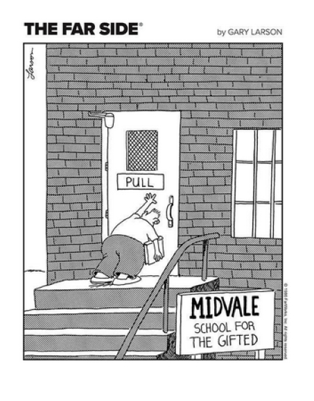

<section class="links" markdown="1">

## Measure it

* [AI Stupid Level (.info)](https://aistupidlevel.info/)
* [AI Stupid Level (.com)](https://aistupidlevel.com/)
* [Bullshit Bench](https://petergpt.github.io/bullshit-benchmark)

## Read about it

* [Marcus on AI](https://garymarcus.substack.com/) — Gary Marcus
* [Where's Your Ed At](https://www.wheresyoured.at/) — Ed Zitron
* [Pivot to AI](https://pivot-to-ai.com/) — David Gerard
* [AI as Normal Technology](https://normaltech.ai/) — Arvind Narayanan & Sayash Kapoor
* [AI Weirdness](https://www.aiweirdness.com/) — Janelle Shane
* [Mystery AI Hype Theater 3000](https://www.dair-institute.org/maiht3k/) — Emily Bender & Alex Hanna

## Keep score

* [AI Incident Database](https://incidentdatabase.ai/)
* [AI Hallucinations - Legal Cases](https://www.damiencharlotin.com/hallucinations/) — Damien Charlotin
* [AI Incidents and Hazards Monitor](https://oecd.ai/en/incidents) - OECD.ai

</section>
<figure>
  
  <figcaption>The Far Side, Gary Larson</figcaption>
</figure>

